<div align="center">



# 🧠 Awesome AI Agent Memory & Frameworks

<p align="center">
  <strong>The definitive curated index of SaaS products, open-source frameworks, and developer infrastructure for stateful, memory-augmented AI agents.</strong>
</p>

<p align="center">
  <a href="https://github.com/ishandutta2007/Awesome-Awesome-Awesome"></a>
  <a href="https://discord.gg/jc4xtF58Ve"></a>
  <a href="https://github.com/ishandutta2007/Awesome-AI-Agent-Memory-Frameworks/stargazers"></a>
  <a href="https://github.com/ishandutta2007/Awesome-AI-Agent-Memory-Frameworks/network/members"></a>
  <a href="https://github.com/ishandutta2007/Awesome-AI-Agent-Memory-Frameworks/blob/main/LICENSE"></a>
  <a href="https://github.com/ishandutta2007/Awesome-AI-Agent-Memory-Frameworks/commits/main"></a>
  <a href="https://github.com/ishandutta2007"></a>
</p>

<p align="center">
  <em>⚡ Focused on Long-Term Memory (LTM), Episodic & Semantic Recall, Stateful Orchestration, Context Window Optimization & Multi-Agent Synchronization ⚡</em>
</p>

---

</div>

## 📑 Table of Contents

- [🌐 Sector Overview & Market Dynamics](#-sector-overview--market-dynamics)
- [🏢 SaaS & Hosted Platforms](#-saas--hosted-platforms)
- [🔓 Open-Source GitHub Projects](#-open-source-github-projects)
- [🧩 Architecture & Memory Paradigms](#-architecture--memory-paradigms)
- [🤝 How to Contribute](#-how-to-contribute)
- [💖 Support & Sponsorship](#-support--sponsorship)
- [📈 Star History](#-star-history)
- [📜 Disclaimer](#-disclaimer)

---

## 🌐 Sector Overview & Market Dynamics

The global **Agentic AI, Orchestration & Memory Systems** market is estimated at **$6B–$8B** and is projected to expand to **$28B–$50B+** by 2030 at a rapid 35%–45% CAGR as software transitions from stateless single-turn LLM chat to persistent, multi-turn autonomous agents. Structurally, the developer and tooling tier remains **moderately fragmented and highly competitive** across specialized vector stores, graph memory layers, and open-source frameworks, while the enterprise managed orchestration layer exhibits powerful **winner-take-most** platform tendencies driven by cloud hyperscalers and dominant infrastructure providers.

---

## 🏢 SaaS & Hosted Platforms

A comprehensive breakdown of commercial SaaS platforms powering production AI agent memory, context caching, checkpointing, and execution environments.

> [!NOTE]
> All SaaS platforms are strictly sorted in descending order by enterprise scale, corporate valuation, and capitalization.

| Company / Platform | Company Scale (Valuation / Revenue) | Starting Paid Pricing | Free Tier Limits | Description & Key Memory Capabilities |
| :--- | :--- | :--- | :--- | :--- |
| **[Microsoft AutoGen / Azure AI Agent Service](https://azure.microsoft.com/en-us/products/ai-services/)** | **~$3.1 Trillion** market cap (Enterprise public hyperscaler) | **Pay-as-you-go** model (e.g., ~$0.0025/1k tokens on GPT-4o-mini; Azure AI Search from $0.34/hr) | **Azure Free Tier**: 12 months free access to popular services + $200 Azure cloud credits (valid 30 days) | Enterprise-grade cloud agent orchestration platform with managed persistent threads, file attachments, and vector-store grounding across Azure AI Foundry. |
| **[LangGraph Cloud / LangSmith](https://www.langchain.com/langgraph)** | **~$1.25B Valuation** ($125M Series B; Unicorn backed by Sequoia/IVP) | **$39 / seat / month** (Plus Plan) | **$0 / month Developer Plan**: 1 seat, hard-capped at 5,000 base traces/month (14-day retention), Prompt Hub & Playground access | Managed platform for stateful multi-agent workflows featuring durable execution, graph checkpointing, conversation rollbacks, and long-term memory threads. |
| **[Dify Cloud](https://dify.ai/)** | **~$180M Valuation** ($30M Series Pre-A led by HSG; ~$3.1M ARR) | **$59 / workspace / month** ($49/mo billed annually for Professional) | **$0 Sandbox Plan**: 1 seat, 5 applications, 200 message credits (to test frontier models), 50 MB / 50 documents knowledge base storage, 30 days log history | Visual LLM application and agent development workspace featuring built-in conversation history, knowledge indexing, and context-retrieval pipelines. |
| **[Botpress](https://botpress.com/)** | **~$120M Valuation** ($40M+ raised; >$10M ARR) | **$150 / month** (Plus Plan, billed annually at $150/mo or $189 monthly) | **$0 / month Community Plan**: Up to 500 incoming messages/conversations, Studio visual builder access, community support, hard-capped storage | Visual and code-level conversational AI platform featuring long-term knowledge retrieval, session memory variables, and integrations. |
| **[CrewAI Enterprise](https://www.crewai.com/)** | **~$50M–$100M Valuation** ($18M Series A backed by Insight Partners) | **Custom Enterprise / Quoted** (starts with custom pilot tiers) | **$0 / month Basic Cloud Plan**: Up to 50 workflow executions/month, CrewAI Studio visual canvas, AI copilot, GitHub integration, tracing & guardrails | Multi-agent collaboration platform with shared memory storage, short-term/long-term episodic recall, and role-based knowledge repositories. |
| **[SuperAGI Cloud](https://superagi.com/)** | **~$25M–$50M Valuation** ($15M raised; backed by Newlands VC & Kae) | **$49 / user / month** (Growth Plan) | **$0 / month Cloud Tier**: 100 platform credits, 20–25 prospects/day activity limit, 2 AI SDR agents (email-only), basic Agentic CRM access | Autonomous agent infrastructure and sales agent platform with persistent agent memory, knowledge embeddings, and action tracing. |
| **[Fixie.ai (Ultravox)](https://fixie.ai/)** | **~$17M Total Funding** (Seed led by Redpoint Ventures & Madrona) | **$100 / month** (Pro Plan) or pay-as-you-go at $0.05/min | **$0 / month Free Tier**: 30 minutes of free voice calls, up to 5 concurrent calls, 1 voice clone, 2 RAG corpora, unlimited playground testing | Voice-native AI agent runtime and infrastructure with fast session persistence, streaming state management, and real-time multimodal context recall. |
| **[Flowise Cloud](https://flowiseai.com/)** | **Acquired by Workday** (YC S23 alum; private enterprise acquisition) | **$35 / month** (Starter Plan for 10,000 predictions/mo) | **$0 / month Free Plan**: 2 active chatflows/assistants, 100 predictions/month, 5 MB vector/document storage, custom embed branding | Drag-and-drop orchestration UI with modular memory nodes (Zep, DynamoDB, Redis, Buffer Memory) to visually assemble conversational agents. |
| **[AgentOps](https://www.agentops.ai/)** | **$2.6M Total Funding** (Seed backed by 645 Ventures & Afore Capital) | **$40 / month** (Pro Plan with pay-as-you-go scaling) | **$0 / month Basic Plan**: Up to 5,000 tracked events/month, agent session replay, LLM token and cost tracking, standard API access | Dedicated observability and operations platform tracking agent execution graphs, recursive memory retrieval errors, and tool-call latency. |

---

## 🔓 Open-Source GitHub Projects

Explore the top open-source repositories powering autonomous agent memory, RAG context injection, and stateful agent coordination.

> [!TIP]
> All open-source projects are strictly sorted in descending order by GitHub Stars_Count. Click any Stars_Badge to view stargazers.

| Project & Repository | GitHub_Stars | Primary Memory & Orchestration Architecture | License |
| :--- | :--- | :--- | :--- |
| **[AutoGPT](https://github.com/Significant-Gravitas/AutoGPT)** | [](https://github.com/Significant-Gravitas/AutoGPT/stargazers) | Pioneer autonomous agent system with recursive task execution, file-backed long-term memory, and continuous execution graphs. | MIT |
| **[Dify](https://github.com/langgenius/dify)** | [](https://github.com/langgenius/dify/stargazers) | Collaborative agentic workflow engine with hybrid RAG context engines, conversation state persistence, and modular tool calling. | Apache-2.0 |
| **[LangChain](https://github.com/langchain-ai/langchain)** | [](https://github.com/langchain-ai/langchain/stargazers) | Universal agent and LLM engineering framework offering memory abstractions (ConversationBuffer, VectorStoreMemory, SummaryMemory). | MIT |
| **[RAGFlow](https://github.com/infiniflow/ragflow)** | [](https://github.com/infiniflow/ragflow/stargazers) | Deep document understanding RAG engine integrating agent capabilities with grounded retrieval memory for rich context synthesis. | Apache-2.0 |
| **[MetaGPT](https://github.com/geekan/MetaGPT)** | [](https://github.com/geekan/MetaGPT/stargazers) | Multi-agent framework incorporating Standard Operating Procedures (SOPs), shared communication buses, and long-term role memory. | MIT |
| **[Mem0](https://github.com/mem0ai/mem0)** | [](https://github.com/mem0ai/mem0/stargazers) | Self-improving personalized memory layer for agents; extracts, updates, and deduplicates user preferences, facts, and conversation context. | Apache-2.0 |
| **[AutoGen](https://github.com/microsoft/autogen)** | [](https://github.com/microsoft/autogen/stargazers) | Multi-agent conversation framework facilitating collaborative dialogue, state transitions, and customizable conversational memory. | Apache-2.0 |
| **[CrewAI](https://github.com/crewAIInc/crewAI)** | [](https://github.com/crewAIInc/crewAI/stargazers) | Role-playing autonomous agent orchestrator with built-in short-term, long-term, and entity memory systems across crew tasks. | MIT |
| **[Flowise](https://github.com/flowiseai/flowise)** | [](https://github.com/flowiseai/flowise/stargazers) | Open-source visual graph interface to build agents with plug-and-play memory blocks (Redis, Upstash, Window Buffer, DynamoDB). | Apache-2.0 |
| **[LlamaIndex](https://github.com/run-llama/llama_index)** | [](https://github.com/run-llama/llama_index/stargazers) | Context augmentation platform with ChatMemoryBuffer, VectorMemory, knowledge graphs, and workflow state engines for LLM applications. | MIT |
| **[LangGraph](https://github.com/langchain-ai/langgraph)** | [](https://github.com/langchain-ai/langgraph/stargazers) | Cyclic graph framework featuring first-class durable state checkpointing, human-in-the-loop inspection, and cross-thread memory stores. | MIT |
| **[Agno (formerly Phidata)](https://github.com/phidatahq/phidata)** | [](https://github.com/phidatahq/phidata/stargazers) | Lightweight framework for multi-modal agents with persistent session memory, PostgreSQL/SQLite storage backends, and tool integrations. | MIT |
| **[ChatDev](https://github.com/OpenBMB/ChatDev)** | [](https://github.com/OpenBMB/ChatDev/stargazers) | Virtual software company framework where collaborative agents communicate through structured dialogue memory to develop code. | Apache-2.0 |
| **[Letta (formerly MemGPT)](https://github.com/letta-ai/letta)** | [](https://github.com/letta-ai/letta/stargazers) | Memory-first agent platform enabling LLMs to act as operating systems—managing hierarchical core context, archival memory, and recall. | Apache-2.0 |
| **[SuperAGI](https://github.com/TransformerOptimus/SuperAGI)** | [](https://github.com/TransformerOptimus/SuperAGI/stargazers) | Autonomous AI agent framework with action consoles, memory storage (Pinecone, Qdrant, Chroma), and concurrent multi-agent spawns. | MIT |
| **[Microsoft Agent Framework](https://github.com/microsoft/agent-framework)** | [](https://github.com/microsoft/agent-framework/stargazers) | Enterprise agent framework (Python and .NET) providing structured session state management, telemetry, and distributed workflows. | MIT |
| **[AgentOps](https://github.com/AgentOps-AI/AgentOps)** | [](https://github.com/AgentOps-AI/AgentOps/stargazers) | SDK for agent monitoring, tracking memory retrieval latencies, recursion depth, model token spend, and multi-agent interactions. | MIT |
| **[Zep](https://github.com/getzep/zep)** | [](https://github.com/getzep/zep/stargazers) | Fast long-term memory store for AI agents; continuously indexes conversations, extracts temporal knowledge graphs, and retrieves facts. | Apache-2.0 |
| **[Ultravox](https://github.com/fixie-ai/ultravox)** | [](https://github.com/fixie-ai/ultravox/stargazers) | Open-weights multimodal speech LLM with real-time audio token processing, streaming conversation context, and tool evaluation. | Apache-2.0 |

---

## 🧩 Architecture & Memory Paradigms

```
┌────────────────────────────────────────────────────────────────────────┐
│                        AGENT COGNITIVE ARCHITECTURE                    │
├────────────────────────────────────────────────────────────────────────┤
│  ⚡ Working Memory (In-Context Window, Scratchpad, Recent Dialogue)    │
│  ────────────────────────────────────────────────────────────────────  │
│  🧠 Short-Term & Episodic Memory (Turn Checkpoints, Thread State)      │
│     └─ e.g. LangGraph Checkpointers, AutoGen Session Context           │
│  ────────────────────────────────────────────────────────────────────  │
│  📚 Long-Term Semantic & Associative Memory (Facts, Entities, Rules)   │
│     └─ e.g. Mem0, Letta (MemGPT), Zep Knowledge Graphs                 │
│  ────────────────────────────────────────────────────────────────────  │
│  💾 Archival & Grounding Layer (Vector DBs, Relational, Object Stores) │
│     └─ e.g. PostgreSQL, Redis, Qdrant, Pinecone, Milvus                │
└────────────────────────────────────────────────────────────────────────┘
```

1. **Working & Short-Term Memory**: Fast, ephemeral session-level state preserved via graph checkpointers (such as in **LangGraph** or **CrewAI**) so agents can be interrupted, inspected, and resumed without losing execution flow.
2. **Episodic Memory**: Structured event logs of past agent runs, enabling agents to avoid repetitive mistakes and learn from past successes across multi-day lifecycles.
3. **Semantic & Fact Memory**: Vectorized or graph-structured memory (championed by **Mem0** and **Zep**) that extracts key user preferences and relational facts, persisting them across disconnected sessions.
4. **Hierarchical OS-Style Memory**: Pattern introduced by **Letta (MemGPT)** where the agent actively manages its context window via function calls to swap data between memory tiers.

---

## 🤝 How to Contribute

We welcome contributions from developers, researchers, and maintainers across the AI agent ecosystem!

1. 🍴 **Fork** this repository.
2. 🌿 **Create a new branch**: `git checkout -b add/my-agent-memory-tool`.
3. ✏️ **Add your entry**: Maintain table alignment, verify exact pricing or GitHub Stars_Counts, and ensure URLs point to the official site/repository.
4. 🚀 **Submit a Pull Request**: Provide a clear explanation of why the framework or tool fits the agent memory and orchestration ecosystem.

---

## 💖 Support & Sponsorship

If you find this curated ecosystem list helpful for your agentic architecture research or production deployments, consider supporting the maintenance of this repository:

- ⭐ **Star this repository** to help others discover it!
- 🍴 **Fork and share** it with your engineering team or community.
- ☕ **Sponsor the maintainer** via GitHub Sponsors:  
  👉 **[Sponsor @ishandutta2007 on GitHub Sponsors](https://github.com/sponsors/ishandutta2007)**

---

## 📈 Star History

[](https://star-history.dera.page/#ishandutta2007/Awesome-AI-Agent-Memory-Frameworks&type=date&legend=top-left)

---

## 📜 Disclaimer

- This list is community-curated for informational, architectural, and educational purposes.
- Agent memory systems frequently store user chat histories, sensitive credentials, and enterprise context. Always audit data retention policies, implement robust encryption at rest/in transit, and ensure compliance with GDPR, HIPAA, and SOC-2 regulations.

---

<div align="center">
  <sub>Maintained with ❤️ by <a href="https://github.com/ishandutta2007">Ishan Dutta</a> and the global open-source AI community.</sub>
</div>
